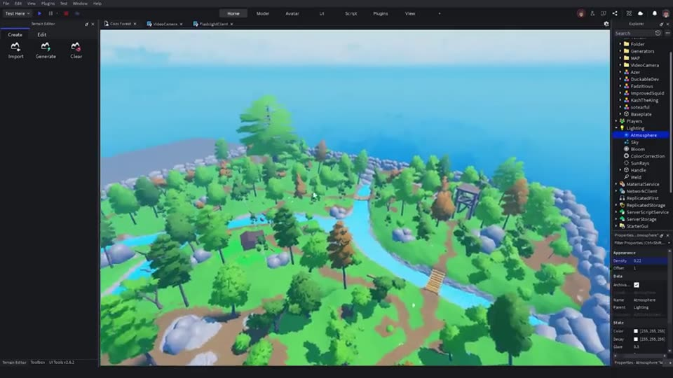
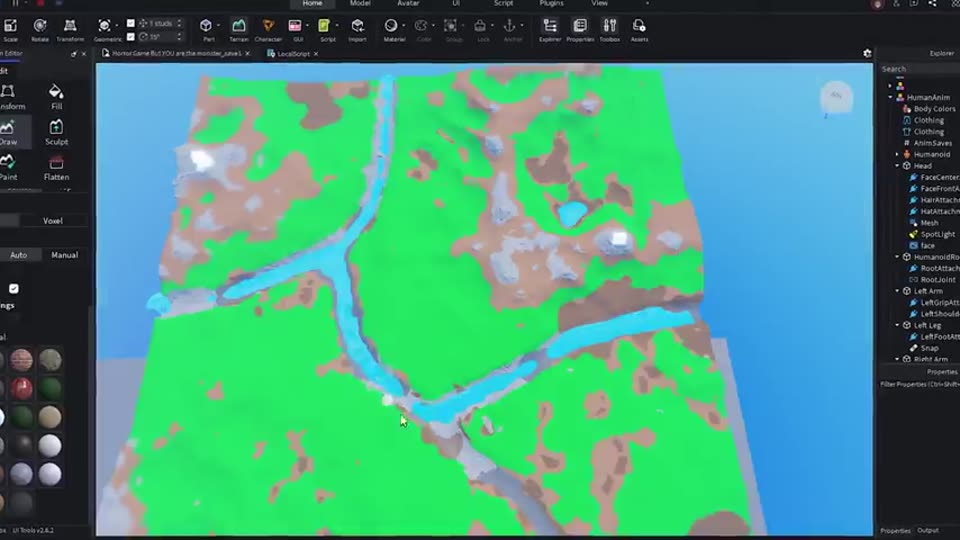
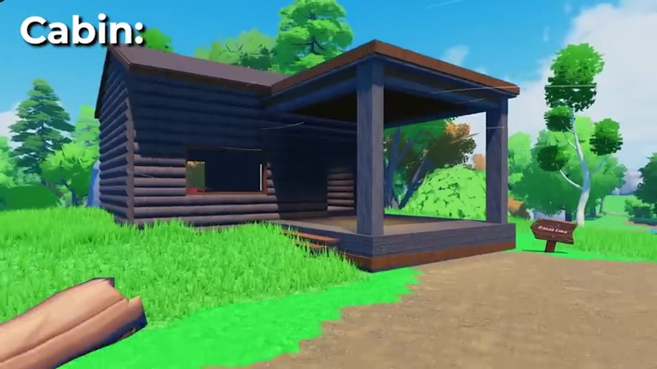
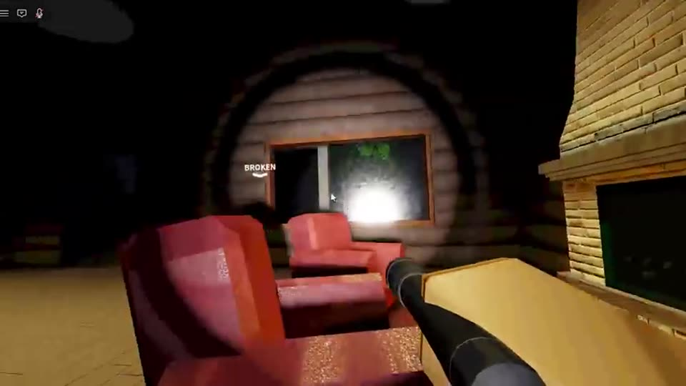
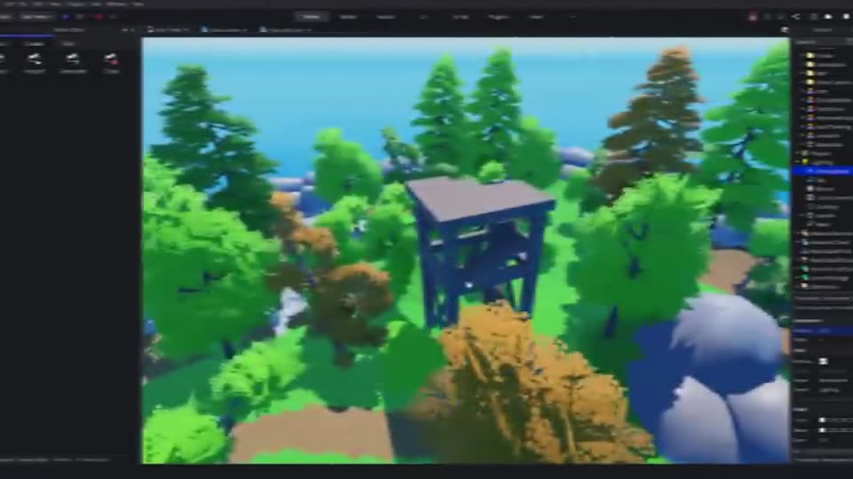
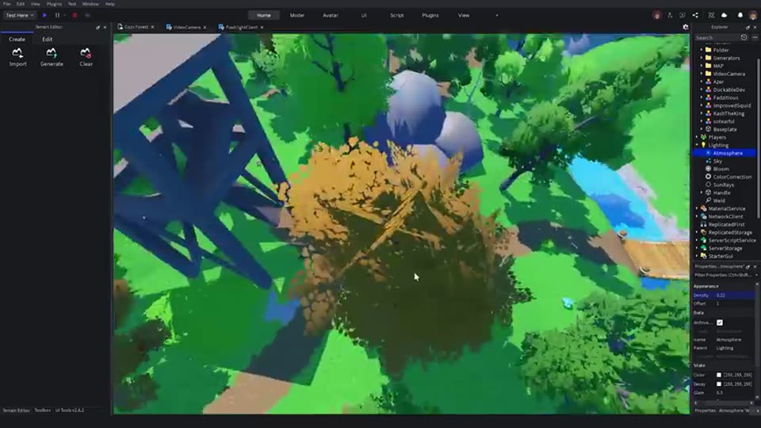
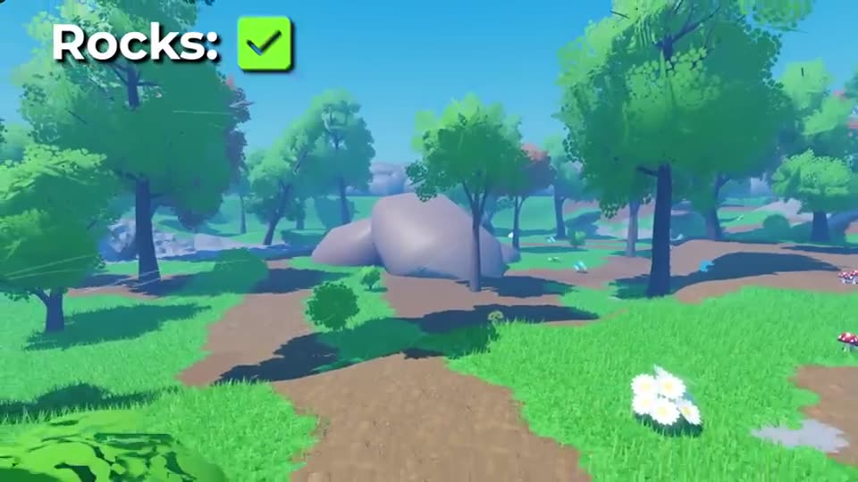
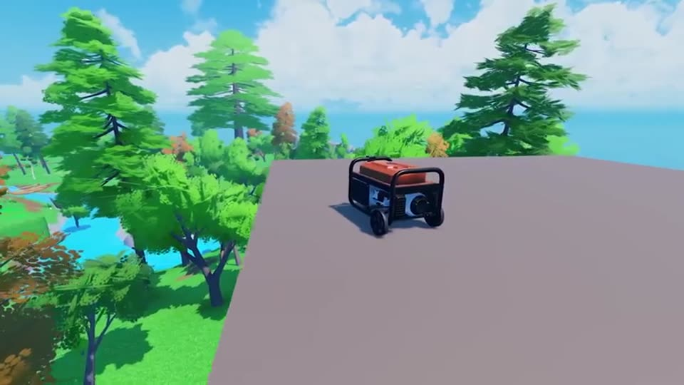

# 11 — La map

Style voulu : **celui de la map de la vidéo de référence**, une forêt pas très grande mais suffisante, avec des points de repère et beaucoup de cachettes. On s'en inspire pour le *type* de map ; la nôtre sera construite par nous (rendu plus réaliste : voir [02-gameplay.md](02-gameplay.md)).

Captures tirées de la vidéo d'Azerr, uniquement comme référence.

## Vue d'ensemble

- Une **île / zone fermée** couverte de forêt, bordée par le décor (pas de sortie).
- Taille modeste : on traverse la map en quelques minutes à pied.
- Une **rivière** qui serpente et coupe la map en zones, avec des ponts.
- Un **réseau de chemins de terre** qui relie toutes les zones.

## Les lieux importants (« landmarks »)

### La cabane (safe house)

- Point de départ et lieu de regroupement : cheminée, fauteuils, lampe.
- **Pas une zone sûre** : le monstre peut y entrer (« il rentre dans la maison ! »).
- Un générateur peut s'y trouver.

### La tour de guet

- Point haut d'où l'on voit loin : les joueurs s'y réfugient en croyant être en sécurité.
- **Le monstre peut l'escalader** : moment de peur garanti.

### Les autres zones
- 5 zones au total dans la vidéo, une par générateur (cabane, tour, zones de forêt, abords de la rivière, cascade).
- Un **arbre géant** comme repère.

## Cachettes et décor

- **Buissons, rochers, gros troncs** : cachettes pour les joueurs… et pour le monstre (apparitions derrière un tronc, dans les buissons).
- Arbres denses le long des chemins : visibilité réduite la nuit.
- Panneaux, barils, caisses, lanternes pour l'ambiance.

## Les générateurs

- Dans la vidéo : **5 générateurs, un par zone**, pour **obliger les joueurs à se séparer**.
- Chez nous : **plusieurs emplacements possibles par zone**, tirage au sort à chaque partie (voir [02-gameplay.md](02-gameplay.md)).

## La nuit
- Obscurité presque totale : sans lampe, on ne voit quasiment rien. Seules quelques sources de lumière (cabane, lanternes).
- C'est ce qui rend la lampe torche vitale… et les screamers dans le faisceau si efficaces.

## Ce que la map doit offrir à l'IA
| Besoin de l'IA | Élément de la map |
|---|---|
| Se cacher / apparaître | Troncs, buissons, rochers, coins de la cabane |
| Déposer un joueur enlevé | Coins **isolés et sombres**, loin des générateurs et de la cabane |
| Séparer le groupe | Générateurs éloignés les uns des autres |
| Leurres sonores | Zones ouvertes où le son porte, forêt dense où on ne voit pas d'où il vient |
| Traques silencieuses | Herbes hautes, chemins bordés d'arbres |
| Points « faussement sûrs » | Cabane, tour de guet |
| Déplacements fiables | Chemins dégagés pour le pathfinding ; points de navigation à placer |

## À préparer dans Roblox Studio (plus tard)
- Dossier `Map/GeneratorSpots` : emplacements possibles des générateurs (parts invisibles).
- Dossier `Map/HideSpots` : cachettes connues (pour que l'IA les surveille).
- Dossier `Map/DropSpots` : coins isolés pour les enlèvements.
- Dossier `Map/MonsterSpawns` : points d'apparition et de disparition du monstre.
- Lumières nommées (cabane, lanternes) pour que le monstre puisse les faire grésiller.

## Direction artistique : l'hyper-réalisme
**Le thème, c'est l'hyper-réalisme.** La map de la vidéo est « cartoon » (style Roblox classique) ; la nôtre doit au contraire **ressembler à une vraie forêt filmée**.

Le principe : **caméra « mauvaise qualité » + monde ultra réaliste = effet found footage**. Le grain, le vignettage et l'objectif imparfait de la caméra dashcam rendent le réalisme encore plus crédible, comme une vraie vidéo trouvée.

Règles visuelles :
- **Textures PBR** partout (couleur, normale, rugosité, métal) : écorce, terre humide, mousse, herbe, roche, bois de la cabane, métal rouillé du générateur.
- **Pas de couleurs saturées** ni de formes « Roblox » (pas de blocs lisses, pas d'arbres en boule).
- **Éclairage réaliste** : Future lighting, ombres douces, brouillard et atmosphère, nuit vraiment noire, lumières chaudes et faibles (lanternes, cabane).
- **Végétation dense et variée** : herbes hautes, fougères, troncs morts, feuilles au sol.
- **Détails crédibles** : objets usés, sales, abandonnés (bidons, outils, panneaux délavés).
- **Performance à surveiller** : Roblox tourne aussi sur téléphone, donc il faut trouver un équilibre entre réalisme et fluidité (niveau de détail, nombre d'objets, StreamingEnabled).

## Construction
- Méthode retenue : **un Claude via Vibestarter** (harnais IA connecté à Roblox Studio et au web) qui construit la map et les bâtiments lui-même, avec des **textures PBR et modèles qu.il télécharge lui-même** (sources ci-dessous).
- Ce Claude devra suivre ce document : lieux, cachettes, besoins de l'IA, et les dossiers `Map/...` listés plus haut.
- Sources et règles techniques : voir les deux sections suivantes.

## Sources des textures et modèles (pour le Claude de Roblox Studio)

Outil utilisé : **Vibestarter**, un harnais pour IA connecté à Roblox Studio et au web. Le Claude qui construit la map **télécharge et uploade lui-même** les ressources. Le créateur vérifie ensuite à la main et remplace celles qui ne lui plaisent pas.

### Sources principales (avec API, à utiliser en automatique)
Toutes en **licence CC0** : gratuites, usage commercial autorisé, aucune attribution obligatoire.

| Site | API | À utiliser pour |
|---|---|---|
| **Poly Haven** — https://polyhaven.com | https://api.polyhaven.com | **Modèles 3D** (arbres, rochers, troncs, plantes), **ciels HDRI**, textures PBR |
| **ambientCG** — https://ambientcg.com | https://ambientcg.com/api | **Textures PBR** : terre, boue, mousse, herbe, écorce, roche, bois, rouille, métal |

Répartition conseillée : **Poly Haven** pour les modèles et le ciel, **ambientCG** pour le sol, l'écorce et les bâtiments.

### Sources secondaires (sans API, téléchargement manuel par le créateur si besoin)
- **cgbookcase** — https://www.cgbookcase.com (CC0, textures naturelles)
- **ShareTextures** — https://www.sharetextures.com (CC0, textures et quelques modèles)
- **3DTextures** — https://3dtextures.me (CC0, beaucoup de matériaux)

## ⚠️ Règles techniques Roblox (à respecter absolument)

### Limite de taille : 1024 × 1024 pixels
- **Roblox réduit automatiquement toute image plus grande que 1024 × 1024.** Télécharger du 2K, 4K ou 8K ne sert à rien : ça gaspille du temps d'upload et peut dégrader le rendu.
- **Toujours télécharger la version 1K** (1024 × 1024) sur Poly Haven et ambientCG. Si seule une version plus grande existe, **la redimensionner à 1024 × 1024 avant l'upload**.
- Des textures plus petites (512 × 512) sont acceptables pour les petits objets lointains, et meilleures pour la fluidité.
- Format : **PNG** ou **JPG**.

### Les cartes PBR à récupérer
Roblox utilise 4 cartes. Correspondance des noms :

| Roblox | Noms courants sur les sites |
|---|---|
| `ColorMap` | Color, Albedo, Diffuse, BaseColor |
| `NormalMap` | Normal (**version OpenGL**, `NormalGL` sur ambientCG ; pas la version DirectX `NormalDX`) |
| `RoughnessMap` | Roughness |
| `MetalnessMap` | Metalness, Metallic (souvent absente pour la nature : laisser vide) |

Les cartes Displacement / Height et AO ne sont pas utilisées par Roblox : ne pas les uploader.

### Comment appliquer les textures
- **`SurfaceAppearance`** (enfant d'une `MeshPart`) : pour les **modèles 3D** (arbres, rochers, cabane, générateur).
- **`MaterialVariant`** (dans `MaterialService`) : pour **remplacer les matériaux du terrain et des parts** (herbe, terre, roche, bois) par des textures réalistes. Régler `StudsPerTile` pour une échelle crédible.

### Upload
- Chaque image doit être **uploadée sur Roblox** (Asset Manager ou Open Cloud) et **passer la modération** avant d'être utilisable. Prévoir un délai.
- Garder une **liste des ressources utilisées** (nom, site, lien, ID Roblox) dans un fichier, par exemple `docs/assets.md`, pour pouvoir remplacer facilement une texture.

### Modèles 3D
- Poly Haven fournit des modèles en haute définition : **réduire le nombre de polygones** si nécessaire. Roblox limite chaque mesh (environ 20 000 triangles) et la fluidité compte.
- Utiliser **plusieurs variantes** d'arbres et de rochers, tournées et redimensionnées, pour éviter l'effet « copier-coller ».

## Questions ouvertes
- Nom des zones et plan précis.
