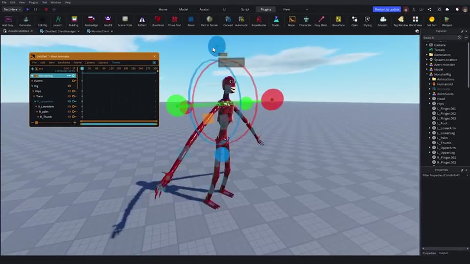
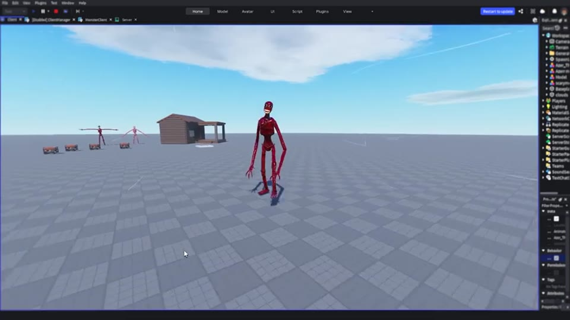
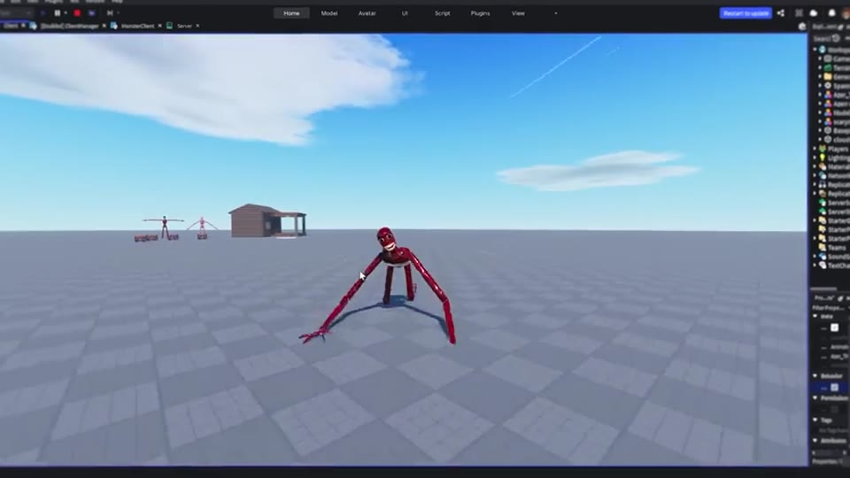
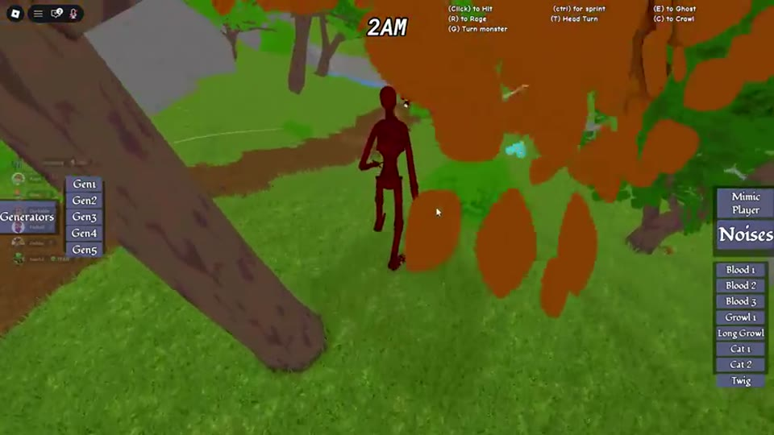
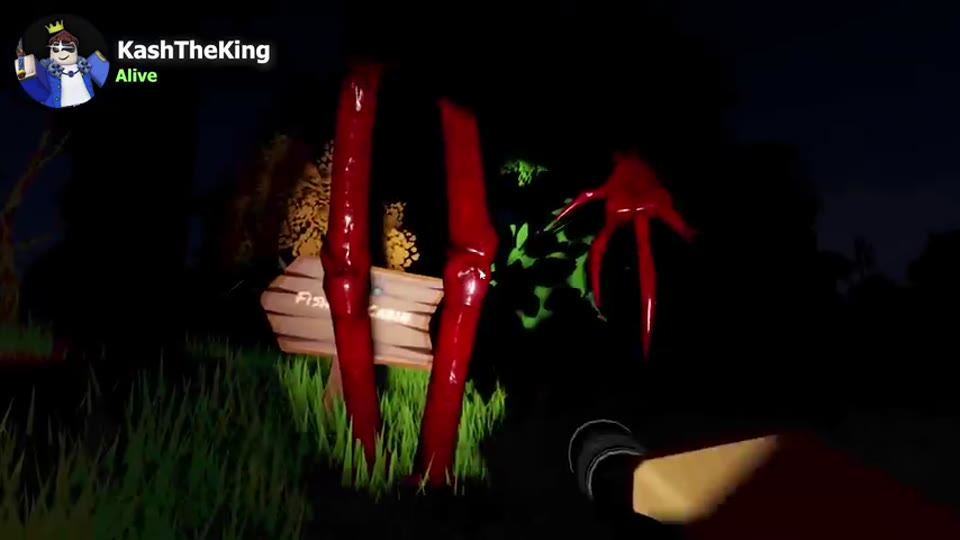
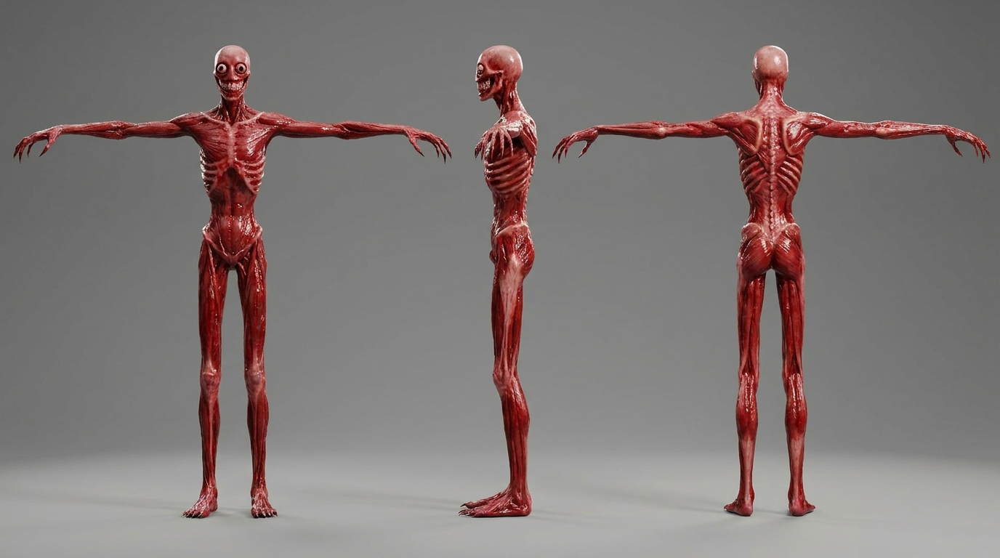
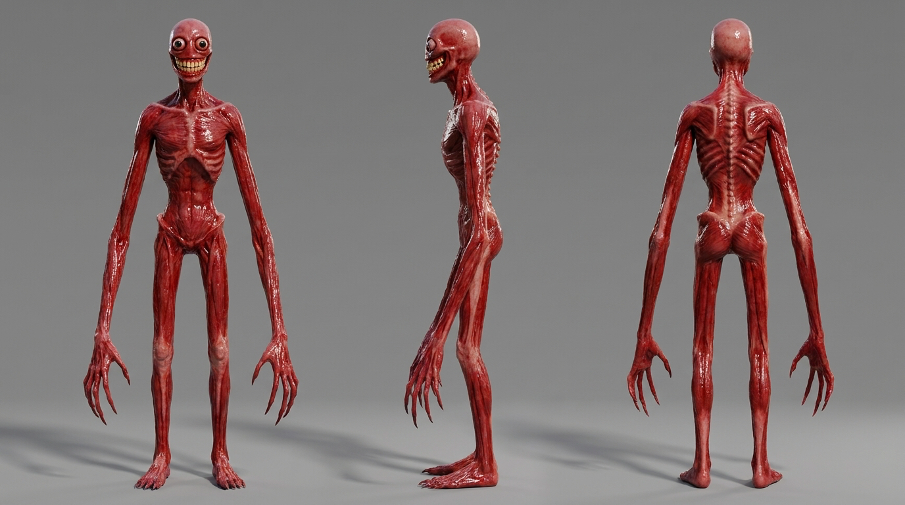
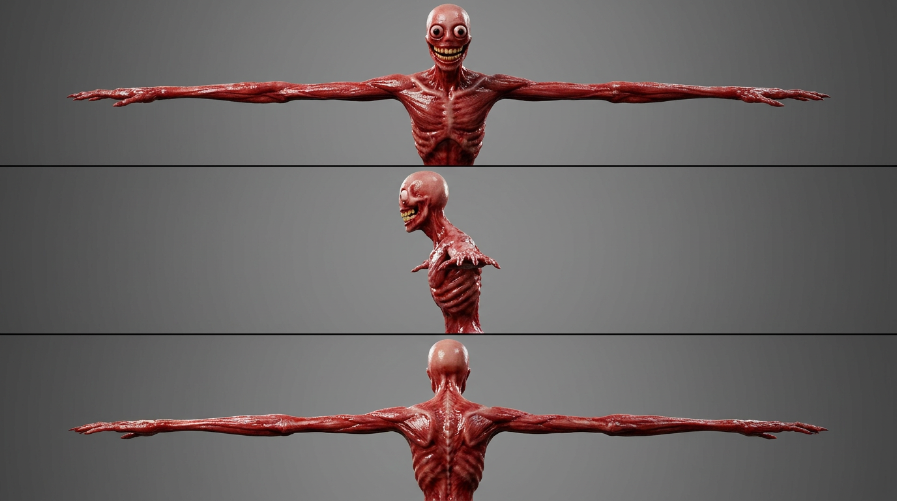

# 12 — Le monstre (design)

**Design original**, inspiré de l'esprit du monstre de la vidéo de référence, mais **hyper-réaliste**. On ne copie ni la créature de la vidéo (elle-même inspirée de *Vita Carnis*) ni l'avatar VRChat « haha beef » (elume).

## Description
- **Très grand** (~2,5 m) et **décharné**, humanoïde.
- Bras et jambes **anormalement longs**, doigts allongés avec griffes.
- **Peau à vif** : muscles rouges humides, tendons visibles, surface luisante.
- **Grands yeux ronds grands ouverts**, injectés de sang, sans paupières.
- **Immense sourire** presque d'une oreille à l'autre, plein de dents humaines.
- Posture voûtée, côtes et colonne saillantes.

## Références (vidéo)
| | |
|---|---|
|  |  |
|  |  |

## Génération (Meshy AI)
1. **Image d'abord** (outil Image, modèle Nano Banana Pro) : Multi-vues activé, **T-Pose**, 3 à 4 images.
2. Choisir la meilleure, puis **Image → 3D** (outil Modèle) : style réaliste, polycount ~15–20k, textures PBR.
3. **Animer** (auto-rigging Meshy) : marche, rampe, course, attaque.
4. Export **FBX**, textures réduites à **1024×1024**.

## Contraintes pour l'IA et la map
- 2,5 m : prévoir une animation pour **se baisser** sous les portes (cabane).
- Animations nécessaires : marcher (pas lourds), ramper (silencieux), courir, grimper, attraper/porter, frapper, dévorer, apparaître/disparaître.

## Images générées (Meshy, Nano Banana Pro)
Dossier : [images/monstre/meshy/](images/monstre/meshy/) — zip : `monstre-meshy.zip` à la racine.

| Version | Description | Usage |
|---|---|---|
| **A** — T-pose | Corps entier, bras en croix, sourire plus discret | Pose idéale pour le rigging |
| **B** — bras le long du corps | Corps entier, **grands yeux, sourire jaune énorme, longues griffes** : le design le plus effrayant | **Design de référence retenu** |
| **C** — buste en T-pose | Haut du corps seulement, visage de la version B | Référence du visage uniquement |

**Recommandation** : viser le visage et les mains de **B** dans la pose de **A**. Image → 3D en multi-vues avec B (face, profil, dos) ; si l'auto-rigging échoue (bras collés au corps), régénérer une version T-pose avec le visage de B.

## Modèles 3D générés
Les deux modèles à comparer en jeu sont dans [assets/monstre/](../assets/monstre/) avec leur fiche technique :
- **A** : riggé (24 os), animations `Walking` et `Running`, 2,5 m ;
- **B** : remesh texturé, sans squelette, 1,9 m.
Tous deux font 10 300 triangles. Textures en 4096×4096 à réduire en 1024×1024 pour Roblox.
